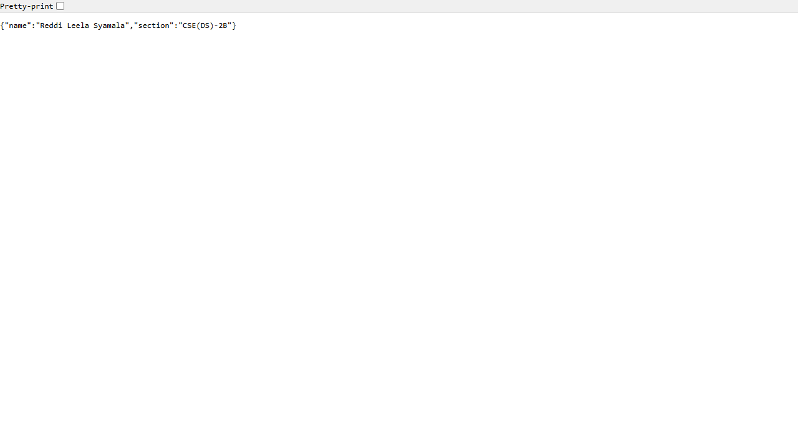
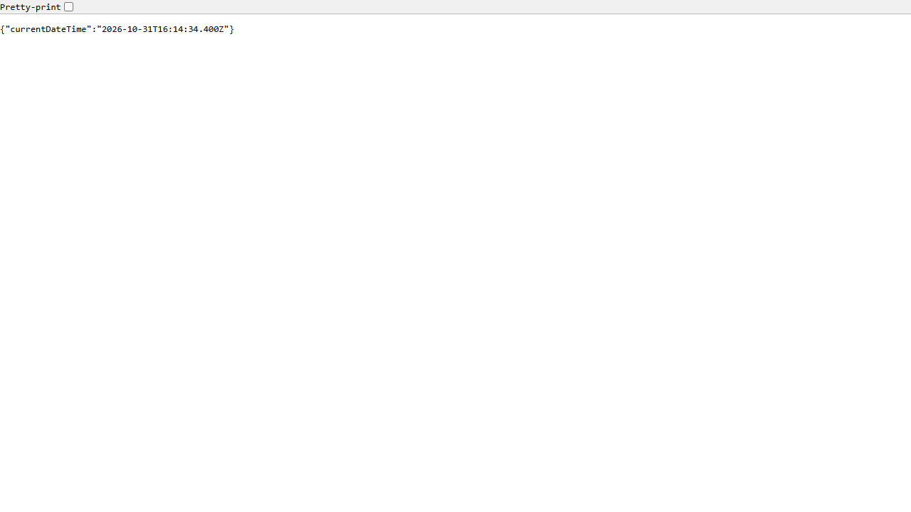

# Lab 1: Node.js and Express Server

## Student Details

- **Name:** Reddi Leela Syamala
- **Registration Number:** [Registration Number]
- **Section:** CSE(DS)-2B
- **Course:** Backend Development Fundamentals
- **Lab Number:** 01

## Live Link

- **Deployment Status:** Local / Deployment Pending
- **Reason:** Deployment credentials or hosting platform integration was not configured. The application is fully prepared for cloud deployment (supports `process.env.PORT || 3000`).
- **To Deploy (e.g. Render / Vercel / Railway):**
  1. Push this repository to GitHub.
  2. Connect your GitHub repository to your hosting service (e.g., Render Web Service or Vercel).
  3. Set Root Directory to `lab-01`.
  4. Set Build Command to `npm install` and Start Command to `node server.js` (or `npm start`).

## Objective

To set up a Node.js project using `npm init -y`, install Express.js, create a basic HTTP server using Node.js's built-in `http` module, and build an Express.js server with multiple endpoints, appropriate HTTP status codes, and error handling for unknown routes.

## Technologies Used

- **Node.js** (v24.15.0)
- **Express.js** (v5.3.0)
- **JavaScript (CommonJS)**
- **npm** (v11.12.1)
- **Visual Studio Code**

## Project Structure

```text
lab-01/
├── screenshots/
│   ├── home.png
│   ├── about.png
│   ├── time.png
│   └── not-found.png
├── server-http.js
├── server.js
├── package.json
├── package-lock.json
├── .gitignore
└── README.md
```

## Explanation of `package.json` Fields

The `package.json` file serves as the manifest for the Node.js project. Key fields include:

- **`name`**: The identifier/name of the project (`"lab-01"`).
- **`version`**: The current semantic version of the application (`"1.0.0"`).
- **`description`**: A brief summary describing the project's purpose.
- **`main`**: The entry point file of the application (`"server.js"`).
- **`scripts`**: Command shortcuts executed via `npm run <script-name>`:
  - `"start"`: Runs `node server.js` to start the Express application.
  - `"start:http"`: Runs `node server-http.js` to launch the built-in HTTP server.
  - `"test"`: Placeholder script for automated tests.
- **`dependencies`**: Lists external third-party libraries required for runtime execution (e.g., `"express": "^5.3.0"`).
- **`license`**: The software license governing the project (`"ISC"`).
- **`type`**: Module system used by Node.js (`"commonjs"`).

## Installation and Setup

### Prerequisites

- Node.js (v18+ recommended) and npm installed
- Terminal / Command Prompt or Visual Studio Code

### Steps to Run

1. Clone or download the repository.
2. Open the terminal and navigate into the `lab-01` directory:

   ```bash
   cd lab-01
   ```

3. Install the dependencies:

   ```bash
   npm install
   ```

4. Start the Express server:

   ```bash
   node server.js
   ```

   *(Alternatively, run `npm start`)*

5. Open your web browser or API client at:

   `http://localhost:3000`

### How to Run the Basic HTTP Server

To test the basic HTTP server built with Node.js's core `http` module:

1. Stop any server currently running on port 3000 (`Ctrl + C`).
2. Run:

   ```bash
   node server-http.js
   ```

   *(Alternatively, run `npm run start:http`)*

3. Visit `http://localhost:3000` to verify the plain-text response: `Hello`.

> **Note:** Stop the running server before starting another server on the same port.

## Endpoints

| Method | Endpoint | Description | Expected Status |
|---|---|---|---|
| GET | `/` | Returns a welcome message | 200 OK |
| GET | `/about` | Returns student name and section in JSON | 200 OK |
| GET | `/time` | Returns the current date and time | 200 OK |
| GET | `/anything` | Demonstrates the response for an unknown route | 404 Not Found |

> **Note on Unknown Routes:** `/anything` is an illustrative example of an undefined route. Any other undefined path (e.g., `/test`, `/random`, `/users`) will also be handled by the catch-all middleware and return HTTP status `404 Not Found` with the body `404 - Page Not Found`.

## Screenshots

### 1. Home Route (`GET /`)
Displays the welcome message with HTTP status `200 OK`.


### 2. About Route (`GET /about`)
Displays the student's name and section in JSON format with HTTP status `200 OK`.



### 3. Time Route (`GET /time`)
Displays the current system date and time generated via `new Date()` with HTTP status `200 OK`.



### 4. Unknown Route (`GET /anything`)
Displays the `404 - Page Not Found` message with HTTP status `404 Not Found`.


## HTTP Status Codes

- **`200 OK`**: Standard response for successful HTTP requests. Returned by `/`, `/about`, and `/time`.
- **`404 Not Found`**: The server cannot find the requested resource or route. Returned for all undefined paths.

## Viva Questions and Answers

### 1. What is the difference between `package.json` and `node_modules`?
- **`package.json`**: A lightweight JSON metadata file tracked by version control that documents project details, configuration, start scripts, and dependencies (with version ranges).
- **`node_modules`**: The physical directory containing the installed JavaScript packages and their transitive dependencies downloaded by npm. It is bulky and should never be committed to Git (always ignored via `.gitignore`).

### 2. What does `app.listen()` do?
`app.listen()` binds and listens for incoming HTTP connections on the specified network port and host. It initializes the underlying Node.js HTTP server and makes the Express application available to handle incoming client requests.

### 3. What do request and response represent?
- **`request` (`req`)**: An object representing the incoming HTTP request from the client. It contains request headers, query parameters, URL path, HTTP method, and body data.
- **`response` (`res`)**: An object used by the server to construct and send back the HTTP response to the client, including HTTP status codes, response headers, and payload (plain text, JSON, or HTML).

## Problems Faced and Solutions

1. **Port 3000 Collision (`EADDRINUSE`)**:
   - *Problem:* Running `server.js` while `server-http.js` was still active caused a port conflict error because both servers default to port 3000.
   - *Solution:* Ensured that the previous process was terminated (`Ctrl + C` or process kill) before launching the alternate server implementation. Added `process.env.PORT || 3000` to allow flexible port assignment.
2. **Actual 404 Status vs Default 200 Response**:
   - *Problem:* A simple handler returning text without explicitly setting `res.status(404)` returns HTTP 200 OK by default, which is semantically incorrect for missing pages.
   - *Solution:* Implemented `response.status(404).send("404 - Page Not Found")` in Express catch-all middleware to send both the correct HTTP 404 status header and a descriptive error message.

## Git and Repository Notes

- The `.gitignore` file explicitly ignores `node_modules/` and `.env`.
- Screenshots are stored under `screenshots/` and referenced via relative markdown paths.
- The project is cleanly structured for submission through the course repository.
