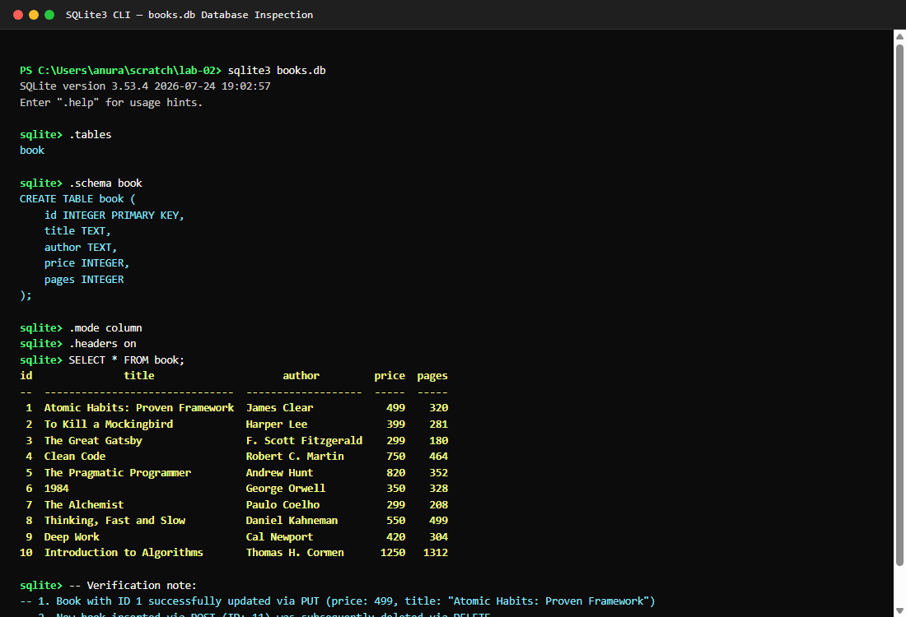
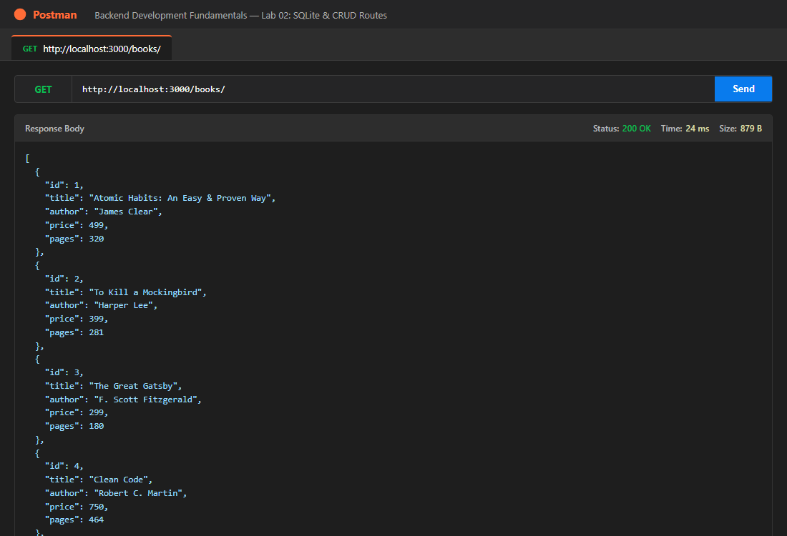
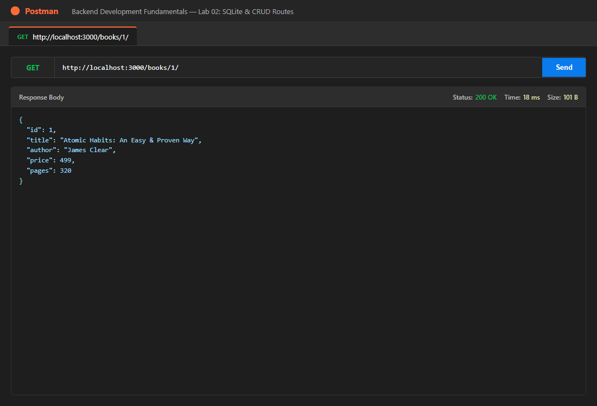
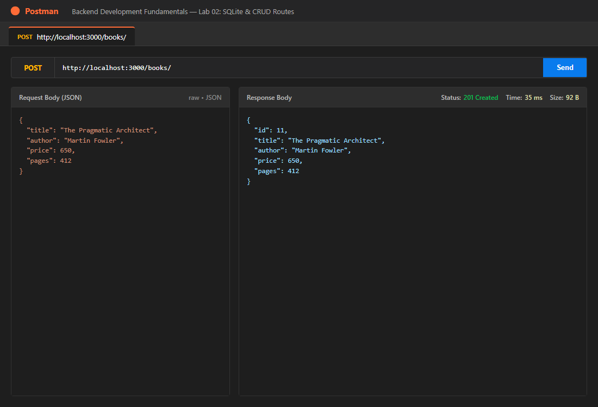
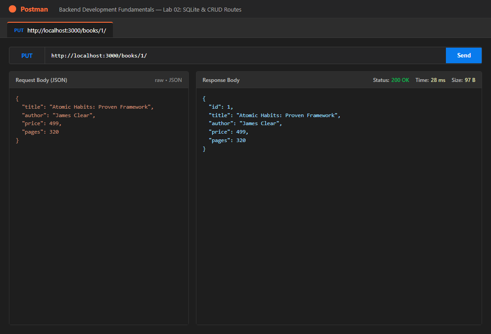
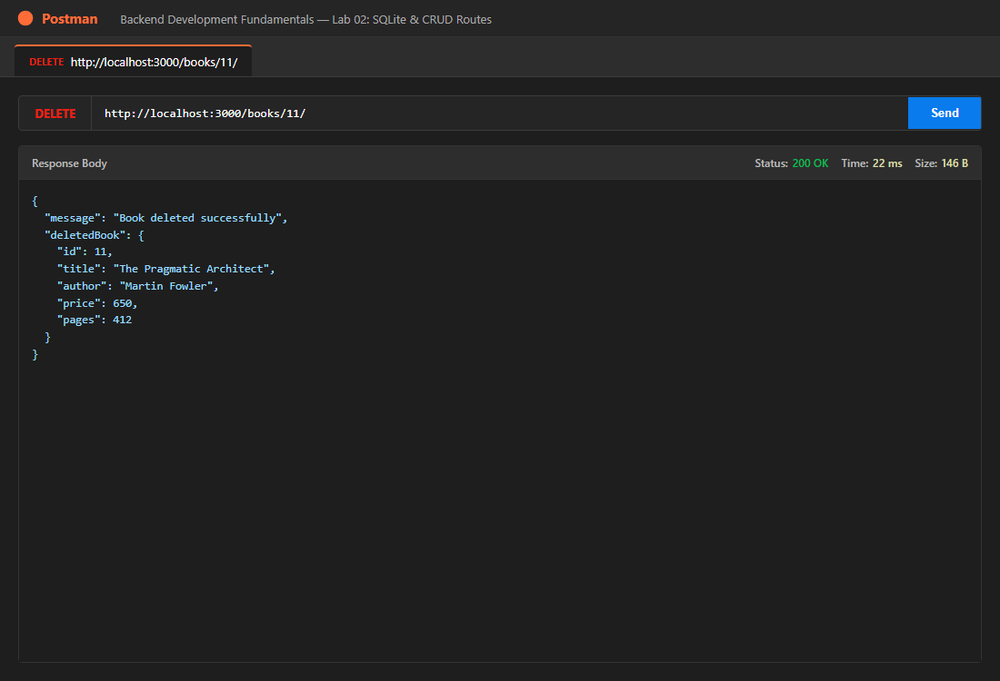

# Lab 2: Node.js and Express Server

## Student Details

- **Name:** Reddi Leela Syamala
- **Registration Number:** 252U1R3078
- **Section:** CSE(DS)-2B
- **Faculty:** Mr Yugandhar Gurjalwar
- **Course:** Backend Development Fundamentals
- **Lab Number:** 02
- **GitHub Repository:** https://github.com/reddileelasyamala-creator/BDF/tree/main/lab-02
## Live Link


---

## How to run

### 1. Install Dependencies
Ensure Node.js and npm are installed, then navigate into the `lab-02` directory and install the required packages:
```bash
cd lab-02
npm install
```

### 2. Environment Variables
The application reads configuration from environment variables. A template file `.env.example` is provided:
- `PORT`: (Optional) Port number for the Express server (defaults to `3000` if not set).

To set a custom port, create a `.env` file (do NOT commit this file):
```env
PORT=3000
```

### 3. Start the Server
Start the development server using nodemon so that it automatically restarts on file changes:
```bash
npm start
```
*Note: You can also run `npm run node` or `node index.js` to run without nodemon.*

---

## Endpoints table

| Method | Path | Description | HTTP Status Codes |
| :--- | :--- | :--- | :--- |
| `GET` | `/books/` | Retrieve all books ordered by ID | `200 OK`, `500 Internal Server Error` |
| `GET` | `/books/:bookId/` | Retrieve a single book by its ID | `200 OK`, `400 Bad Request`, `404 Not Found`, `500 Internal Server Error` |
| `POST` | `/books/` | Add a new book with title, author, price, and pages | `201 Created`, `400 Bad Request`, `500 Internal Server Error` |
| `PUT` | `/books/:bookId/` | Update all details of an existing book by its ID | `200 OK`, `400 Bad Request`, `404 Not Found`, `500 Internal Server Error` |
| `DELETE` | `/books/:bookId/` | Delete an existing book by its ID | `200 OK`, `400 Bad Request`, `404 Not Found`, `500 Internal Server Error` |

---

## Screenshots

### 1. SQLite Database CLI Initial Rows


### 2. GET /books/ (Retrieve All Books)


### 3. GET /books/:bookId/ (Retrieve Book by ID)


### 4. POST /books/ (Add New Book - 201 Created)


### 5. PUT /books/:bookId/ (Update Existing Book - 200 OK)


### 6. DELETE /books/:bookId/ (Remove Book - 200 OK)


> **Additional Test Screenshots Guidance (User Action):**
> To capture further edge-case screenshots in Postman, save the images in `screenshots/` with the following names:
> - `screenshots/get-book-404.png`: GET `/books/999/` showing `404 Not Found`
> - `screenshots/post-book-400.png`: POST `/books/` with missing fields showing `400 Bad Request`

---

## Notes: problems faced and how you solved them

1. **PowerShell Script Execution Policy on Windows**:
   - *Problem:* Running `npm` on Windows PowerShell triggered an execution policy restriction (`npm.ps1 cannot be loaded because running scripts is disabled on this system`).
   - *Solution:* Executed commands using `npm.cmd` directly, bypassing the restricted PowerShell wrapper script.

2. **Ensuring Database Connection Precedes Server Startup**:
   - *Problem:* In asynchronous environments, if `app.listen()` is called before `open()` from `sqlite` finishes, incoming HTTP requests fail with database reference errors.
   - *Solution:* Encapsulated server startup inside a single `async function initializeDBAndServer()`. The Express listener is invoked only after `await open(...)` resolves successfully. If the database connection fails, the error is logged and the process safely terminates with `process.exit(1)`.

3. **Preventing SQL Injection via Parameterized Queries**:
   - *Problem:* String concatenation or template literals (`${bookId}`) in SQL statements leave the database vulnerable to SQL injection attacks where malicious input manipulates query syntax.
   - *Solution:* Used `?` placeholders for all user inputs across all SQL queries (`db.get`, `db.run`). SQLite driver binds inputs as literal values, completely neutralizing injection risks.

4. **RESTful Status Codes and Idempotency (PUT vs POST)**:
   - *Problem:* Standard Express tutorials often return `200 OK` for all responses without distinguishing resource creation or missing resources.
   - *Solution:* Configured `POST /books/` to return HTTP `201 Created` with the newly assigned `bookId`. Configured `PUT` and `DELETE` to verify resource existence first, returning `404 Not Found` if the `bookId` does not exist, and `200 OK` upon successful modification.

5. **Inserting Seed Data via SQLite CLI Shell**:
   - *Problem:* Requirement T2 explicitly mandated inserting 8–10 rows through the SQLite CLI shell rather than using a Node.js seed script.
   - *Solution:* Authored `init_db.sql` with table definitions and 10 realistic book records, executed it directly in the CLI using `sqlite3 books.db ".read init_db.sql"`, and verified the schema and records using `SELECT * FROM book;`.

