# Lab 3: RESTful API Development, Query Parameters, Validation and Debugging

## Student Details

- **Name:** Reddi Leela Syamala
- **Registration Number:** 252U1R3078
- **Section:** CSE(DS)-2B
- **Faculty:** Mr Yugandhar Gurjalwar
- **Course:** Backend Development Fundamentals
- **Lab Number:** 03
- **GitHub Repository:** [BDF - Lab 3](https://github.com/reddileelasyamala-creator/BDF/tree/main/lab-03)

---
Live link: https://bdf-lab-3-3yxi.onrender.com 

## Objective

To develop a production-ready, robust RESTful API using Node.js, Express.js, and SQLite that manages a book collection. The API extends foundational CRUD operations with advanced capabilities including:
- Query parameters for dynamic searching (`search_q`), column sorting (`order_by`, `order`), pagination (`limit`, `offset`), and price range filtering (`min_price`, `max_price`).
- Strict server-side request validation ensuring malformed payloads, invalid IDs, and illegal query parameters are rejected with appropriate HTTP status codes.
- Whitelist-based sorting validation and parameterized SQL queries to prevent SQL injection vulnerabilities.
- Consistent, predictable JSON responses for both successful operations and error handling.
- Practical debugging methodologies for common backend errors (`EADDRINUSE`, wrong module import paths, incorrect database table names, and missing `await` statements).

---

## Technologies Used

- **Runtime Environment:** Node.js (v24.x)
- **Web Framework:** Express.js (v5.x)
- **Database Engine:** SQLite3 (v3.53.x CLI and native driver)
- **Database Wrapper:** `sqlite` (v5.x async promise-based driver) and `sqlite3` (v6.x)
- **Programming Language:** JavaScript (ES6+ CommonJS)
- **Package Manager:** npm (v11.x)
- **Development Tool:** Nodemon (v3.x for automatic server reloading)
- **API Testing:** Postman Desktop Application & native HTTP test suites
- **Version Control:** Git and GitHub

---

## Project Structure

```text
lab-03/
│
├── server.js                        # Main Express application, routes, and DB initialization
├── init_db.sql                      # SQL seed script with schema and initial 10 records
├── books.db                         # SQLite database file containing the book table
├── package.json                     # Project manifest, dependencies, and execution scripts
├── package-lock.json                # Locked dependency tree
├── .gitignore                       # Ignores node_modules/ and .env; tracks books.db
├── Lab-03-Postman-Collection.json   # Pre-configured 14-test Postman collection for 1-click testing
├── README.md                        # Complete project documentation and viva guide
└── screenshots/                     # Genuine Postman test execution screenshots
    ├── 01-get-all-books.png         # 1. GET All Books (200 OK)
    ├── 02-get-book-by-id.png        # 2. GET Book by ID (Valid - 200 OK)
    ├── 03-search-books.png          # 3. Search Books (search_q=George)
    ├── 04-sort-books.png            # 4. Sort Books (order_by=price & order=desc)
    ├── 05-pagination.png            # 5. Pagination (limit=3 & offset=2)
    ├── 06-price-filter.png          # 6. Price Filter (min_price=300 & max_price=450)
    ├── 07-combined-query.png        # 7. Combined Query (search + sort + filter + pagination)
    ├── 08-post-valid-book.png       # 8. POST Valid Book (201 Created)
    ├── 09-post-invalid-book.png     # 9. POST Invalid Book (Missing Fields - 400 Bad Request)
    ├── 10-put-existing-book.png     # 10. PUT Existing Book (200 OK)
    ├── 11-put-nonexistent-book.png  # 11. PUT Nonexistent Book (404 Not Found)
    ├── 12-delete-existing-book.png  # 12. DELETE Existing Book (200 OK)
    ├── 13-delete-nonexistent-book.png # 13. DELETE Nonexistent Book (404 Not Found)
    └── 14-invalid-query.png         # 14. Invalid Query Parameter (min_price > max_price - 400 Bad Request)
```

---

## Database Schema & Seed Data

### Table Definition
The application uses SQLite as an embedded relational database. The `book` table is defined as follows:

```sql
CREATE TABLE IF NOT EXISTS book (
    id INTEGER PRIMARY KEY,
    title TEXT,
    author TEXT,
    price INTEGER,
    pages INTEGER
);
```

### Seed Data
The database is pre-seeded with 10 realistic, diverse book records via `init_db.sql`:

| id | title | author | price (₹) | pages |
|:---|:---|:---|:---:|:---:|
| 1 | To Kill a Mockingbird | Harper Lee | 350 | 281 |
| 2 | 1984 | George Orwell | 299 | 328 |
| 3 | The Great Gatsby | F. Scott Fitzgerald | 250 | 180 |
| 4 | Pride and Prejudice | Jane Austen | 320 | 279 |
| 5 | The Catcher in the Rye | J.D. Salinger | 399 | 234 |
| 6 | The Hobbit | J.R.R. Tolkien | 450 | 310 |
| 7 | Fahrenheit 451 | Ray Bradbury | 280 | 256 |
| 8 | Jane Eyre | Charlotte Bronte | 310 | 500 |
| 9 | Clean Code | Robert C. Martin | 750 | 464 |
| 10 | The Pragmatic Programmer | Andrew Hunt and David Thomas | 620 | 352 |

> **Duplicate Prevention:** Seeding uses `INSERT OR IGNORE INTO book` statements, ensuring that restarting the server or re-running initialization scripts will never generate duplicate rows.

---

## Installation & Setup

### 1. Prerequisites
Ensure Node.js and npm are installed on your machine:
```bash
node -v
npm -v
```

### 2. Navigate to Project Directory
```bash
cd lab-03
```

### 3. Install Dependencies
Install all required production and development dependencies:
```bash
npm install
```
*(On Windows PowerShell systems where script execution is restricted, execute `npm.cmd install`)*

---

## Execution Commands

### Development Mode (with Nodemon)
Starts the application with Nodemon, which monitors files and automatically restarts the server upon file changes:
```bash
npm start
```
*Alternative: `npm run dev`*

### Production Mode (Standard Node.js)
Starts the application using standard Node.js without development overhead:
```bash
node server.js
```
*Alternative: `npm run node`*

### Environment Variables
The application dynamically adapts to environment variables:
- `PORT`: HTTP port to bind (default: `3000`).
- `DB_PATH`: Custom path to `books.db` (default: local `books.db` via `path.join(__dirname, "books.db")`).

---

## API Endpoints Overview

| Method | Endpoint | Description | Status Codes |
|:---|:---|:---|:---|
| `GET` | `/` | API welcome, version, and route directory | `200 OK` |
| `GET` | `/health/` | Service health check and uptime monitor | `200 OK` |
| `GET` | `/books/` | List books with search, sort, pagination, and filter | `200 OK`, `400 Bad Request`, `500 Server Error` |
| `GET` | `/books/:bookId/` | Retrieve a specific book by ID | `200 OK`, `400 Bad Request`, `404 Not Found`, `500 Server Error` |
| `POST` | `/books/` | Create a new book record | `201 Created`, `400 Bad Request`, `500 Server Error` |
| `PUT` | `/books/:bookId/` | Update all details of an existing book | `200 OK`, `400 Bad Request`, `404 Not Found`, `500 Server Error` |
| `DELETE`| `/books/:bookId/` | Remove a book record by ID | `200 OK`, `400 Bad Request`, `404 Not Found`, `500 Server Error` |

---

## Query Parameters (`GET /books/`)

The `GET /books/` endpoint supports versatile, combinable query parameters:

### 1. Search (`search_q`)
Searches case-insensitively across book `title` and `author`.
- **Example:** `GET /books/?search_q=George`
- **Result:** Returns books where title or author contains "George" (e.g., *1984* by George Orwell).

### 2. Sorting (`order_by` and `order`)
Sorts records by a specified column in ascending or descending direction.
- **Whitelist of Columns (`order_by`):** `id`, `title`, `price`, `pages`.
- **Allowed Directions (`order`):** `ASC`, `DESC` (case-insensitive).
- **Default:** `order_by=id` and `order=ASC`.
- **Example:** `GET /books/?order_by=price&order=desc`

### 3. Pagination (`limit` and `offset`)
Divides large result sets into discrete chunks.
- `limit`: Maximum number of books returned (must be positive integer > 0).
- `offset`: Number of books skipped (must be non-negative integer >= 0).
- **Example:** `GET /books/?limit=3&offset=2`

### 4. Price Filtering (`min_price` and `max_price`)
Filters books within a specified price boundary.
- `min_price`: Books with `price >= min_price`.
- `max_price`: Books with `price <= max_price`.
- **Validation:** Both must be non-negative numbers; `min_price` cannot exceed `max_price`.
- **Example:** `GET /books/?min_price=300&max_price=450`

### 5. Combined Multi-Parameter Queries
All parameters can be chained together seamlessly:
```text
GET /books/?search_q=the&order_by=price&order=asc&min_price=200&max_price=500&limit=3&offset=0
```

---

## Implementation Details

### Whitelist-Based Sorting (Preventing SQL Injection)
SQL parameters (`?`) cannot be used for SQL identifiers like column names (`ORDER BY ?`) because SQLite treats bound parameters as string literals (e.g., `ORDER BY 'price'`), which results in a no-op sort. Directly concatenating user input (`ORDER BY ${req.query.order_by}`) creates a severe SQL injection vulnerability.

**Solution:**
We implement an explicit whitelist validation:
```javascript
const allowedSortColumns = ["id", "title", "price", "pages"];
if (order_by !== undefined) {
  const lowerOrderBy = order_by.toLowerCase().trim();
  if (!allowedSortColumns.includes(lowerOrderBy)) {
    return response.status(400).json({
      error: true,
      message: `Invalid order_by field: '${order_by}'. Allowed fields are: id, title, price, pages`
    });
  }
  sortColumn = lowerOrderBy;
}
```

### Parameterized SQL Queries
All user-supplied filter and search values are passed to SQLite exclusively through parameter arrays:
```javascript
const whereConditions = [];
const queryParams = [];

if (search_q !== undefined && search_q.trim() !== "") {
  whereConditions.push("(title LIKE ? OR author LIKE ?)");
  queryParams.push(`%${search_q.trim()}%`, `%${search_q.trim()}%`);
}

if (parsedMinPrice !== null) {
  whereConditions.push("price >= ?");
  queryParams.push(parsedMinPrice);
}

if (parsedMaxPrice !== null) {
  whereConditions.push("price <= ?");
  queryParams.push(parsedMaxPrice);
}
```

---

## Request Validation & Consistent JSON Responses

### Validation Matrix

| Field / Parameter | Validation Rule | Invalid Value Example | HTTP Status | Response Message |
|:---|:---|:---|:---:|:---|
| `bookId` | Positive integer | `abc`, `-4`, `0` | `400` | `"Invalid book ID. ID must be a positive integer"` |
| `order_by` | One of `id`, `title`, `price`, `pages` | `rating`, `password` | `400` | `"Invalid order_by field: '...'. Allowed fields are: id, title, price, pages"` |
| `order` | One of `ASC`, `DESC` | `sideways`, `random` | `400` | `"Invalid order direction: '...'. Allowed values are: ASC, DESC"` |
| `limit` | Integer > 0 | `-5`, `0`, `many` | `400` | `"Invalid limit value. Limit must be a positive integer"` |
| `offset` | Integer >= 0 | `-1`, `abc` | `400` | `"Invalid offset value. Offset must be a non-negative integer"` |
| `min_price` | Number >= 0 | `-100`, `free` | `400` | `"Invalid min_price value. min_price must be a non-negative number"` |
| `max_price` | Number >= 0 | `-20`, `expensive` | `400` | `"Invalid max_price value. max_price must be a non-negative number"` |
| Price Range | `min_price <= max_price` | `min=800&max=200` | `400` | `"min_price cannot be greater than max_price"` |
| `title` | Non-empty string | `""`, `null`, `undefined` | `400` | `"Missing or invalid title. Title must be a non-empty string"` |
| `author` | Non-empty string | `""`, `null`, `undefined` | `400` | `"Missing or invalid author. Author must be a non-empty string"` |
| `price` | Number > 0 | `0`, `-50`, `"free"` | `400` | `"Invalid price value. Price must be a positive number"` |
| `pages` | Integer > 0 | `0`, `-10`, `3.5` | `400` | `"Invalid pages value. Pages must be a positive integer"` |
| Request Body | Valid JSON object | `"{bad json"`, `{}` | `400` | `"Request body cannot be empty"` / `"Malformed JSON payload..."` |
| Resource Existence | Must exist in SQLite | `id = 999` | `404` | `"Book not found"` |

### Consistent JSON Structure

**Success Response (e.g. POST):**
```json
{
  "message": "Book Added Successfully",
  "bookId": 11
}
```

**Success Response (e.g. PUT):**
```json
{
  "message": "Book Updated Successfully"
}
```

**Error Response:**
```json
{
  "error": true,
  "message": "Invalid price value. Price must be a positive number"
}
```

---

## Debugging Four Errors

### Error 1: EADDRINUSE

- **Description:** Port conflict error when attempting to start an Express server on a port that is already occupied by another running process.
- **Cause:** A previous instance of `node server.js` was not terminated properly, or another local service is actively bound to port 3000.
- **Incorrect Code / Situation:**
  ```javascript
  // Running two instances simultaneously on port 3000:
  app.listen(3000); // Throws Error: listen EADDRINUSE: address already in use :::3000
  ```
- **Correct Solution:**
  1. Check for active processes listening on port 3000 using PowerShell / Command Prompt:
     ```powershell
     Get-NetTCPConnection -LocalPort 3000
     ```
  2. Terminate the conflicting process:
     ```powershell
     Stop-Process -Id <PID> -Force
     ```
  3. Ensure the server uses dynamic environment configuration:
     ```javascript
     const PORT = process.env.PORT || 3000;
     ```
- **Expected Output:**
  ```text
  Server running at http://localhost:3000/
  ```

---

### Error 2: Wrong Import Path

- **Description:** `MODULE_NOT_FOUND` exception occurring when Node.js cannot resolve a required dependency or file module.
- **Cause:** Specifying an incorrect relative path (e.g. `require("./sqlite")` instead of `require("sqlite")`) or importing a file that does not exist.
- **Incorrect Code:**
  ```javascript
  // Incorrect: treating an npm package as a local relative file
  const { open } = require("./sqlite"); 
  ```
- **Terminal Error Output:**
  ```text
  Error [MODULE_NOT_FOUND]: Cannot find module './sqlite'
  Require stack:
  - C:\...\lab-03\server.js
  ```
- **Correct Solution:**
  Understand module resolution rules:
  - Bare module names (e.g. `require("sqlite")`) tell Node.js to look inside `node_modules`.
  - Relative module paths (e.g. `require("./routes/books")`) tell Node.js to resolve files strictly relative to the current file's directory.
  ```javascript
  const { open } = require("sqlite");
  const sqlite3 = require("sqlite3");
  ```
- **Expected Output:**
  Modules load without errors and server boots successfully.

---

### Error 3: Incorrect Table Name

- **Description:** SQLite query execution failure resulting in `SQLITE_ERROR: no such table`.
- **Cause:** Typing an incorrect or pluralized table name (e.g., `SELECT * FROM books;` instead of `SELECT * FROM book;`).
- **Incorrect Code:**
  ```javascript
  const books = await db.all("SELECT * FROM books;");
  ```
- **Terminal Error Output:**
  ```text
  [Error: SQLITE_ERROR: no such table: books] {
    errno: 1,
    code: 'SQLITE_ERROR'
  }
  ```
- **Correct Solution:**
  1. Inspect the SQLite schema using SQLite CLI:
     ```bash
     sqlite3 books.db ".schema"
     ```
  2. Confirm the exact table name is `book` (singular).
  3. Update the SQL query to match:
     ```javascript
     const books = await db.all("SELECT * FROM book;");
     ```
- **Expected Output:**
  Returns an array of rows matching the query.

---

### Error 4: Missing Await

- **Description:** Asynchronous database calls returning a pending `Promise` object rather than the resolved data rows.
- **Cause:** Omitting the `await` keyword before `db.all()`, `db.get()`, or `db.run()`.
- **Incorrect Code:**
  ```javascript
  app.get("/books/", async (request, response) => {
    // Missing await keyword:
    const books = db.all("SELECT * FROM book;");
    response.status(200).json(books); // Sends empty object {} because Promise is pending!
  });
  ```
- **Observed Behavior:**
  - `console.log(books)` outputs: `Promise { <pending> }`.
  - Express serializes the unawaited Promise into an empty JSON object `{}` instead of the array of book objects.
- **Correct Solution:**
  Always `await` the asynchronous database Promise inside the `async` handler:
  ```javascript
  app.get("/books/", async (request, response) => {
    const books = await db.all("SELECT * FROM book;");
    response.status(200).json(books);
  });
  ```
- **Expected Output:**
  JSON array containing full book records `[{ id: 1, title: "To Kill a Mockingbird", ... }]`.

---

## Postman Testing Guide

A complete, pre-configured collection file is included in this repository:
[`Lab-03-Postman-Collection.json`](./Lab-03-Postman-Collection.json).

### How to Run in Postman Desktop:
1. Open the **Postman Desktop Application**.
2. Click **Import** (top left) and select `lab-03/Lab-03-Postman-Collection.json`.
3. Start the local server:
   ```bash
   npm start
   ```
4. Click and send each of the 15 pre-configured requests.
5. Capture genuine screenshots using Windows Snipping Tool (`Win + Shift + S`) and save them into `lab-03/screenshots/`.

### Verified Test Cases:
1. `GET /books/` (All 10 books) -> `200 OK`
2. `GET /books/1/` (Single book) -> `200 OK`
3. `GET /books/?search_q=George` (Search title & author) -> `200 OK`
4. `GET /books/?order_by=price&order=desc` (Sorted descending by price) -> `200 OK`
5. `GET /books/?limit=3&offset=2` (Pagination) -> `200 OK`
6. `GET /books/?min_price=300&max_price=450` (Price range filter) -> `200 OK`
7. `GET /books/?search_q=the&order_by=price&order=asc&min_price=200&max_price=500&limit=3&offset=0` (Combined parameters) -> `200 OK`
8. `POST /books/` (Valid book JSON) -> `201 Created`
9. `POST /books/` (Invalid / non-numeric price data) -> `400 Bad Request`
10. `PUT /books/1/` (Update book details) -> `200 OK`
11. `PUT /books/999/` (Update non-existent book) -> `404 Not Found`
12. `DELETE /books/10/` (Delete existing book) -> `200 OK`
13. `DELETE /books/999/` (Delete non-existent book) -> `404 Not Found`
14. `GET /books/?min_price=800&max_price=200` (Inverted price range validation) -> `400 Bad Request`

---

## Postman Testing Screenshots (14 Verified Test Cases)

### 1. GET All Books (`GET /books/` - 200 OK)
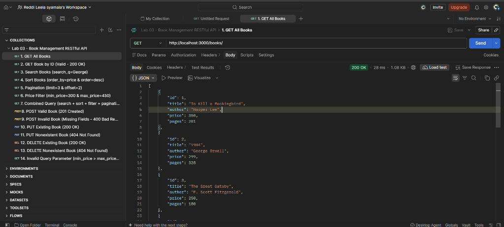
*Retrieves all books stored in SQLite database with HTTP 200 OK status.*

### 2. GET Book by ID (`GET /books/1/` - 200 OK)
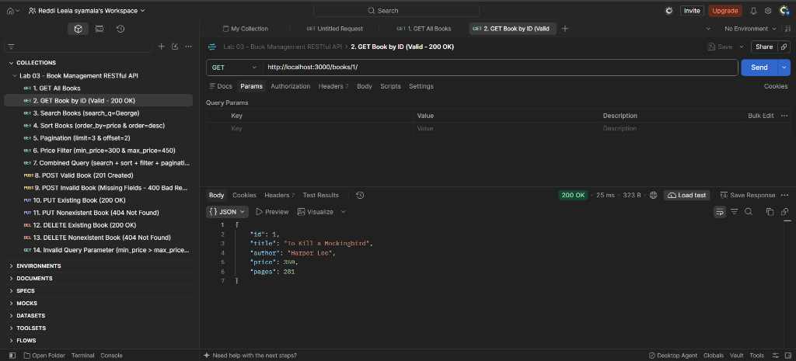
*Retrieves a specific book record by its primary key ID (ID: 1 - "To Kill a Mockingbird") returning HTTP 200 OK.*

### 3. Search Books (`GET /books/?search_q=George` - 200 OK)
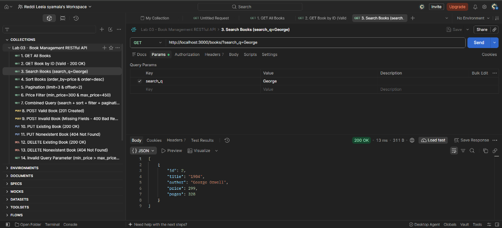
*Case-insensitive search on title and author for "George", successfully returning "1984" by George Orwell.*

### 4. Sort Books (`GET /books/?order_by=price&order=desc` - 200 OK)
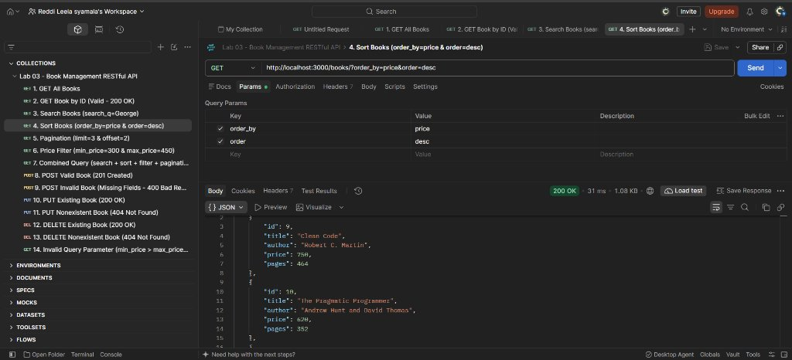
*Sorts books descending by price using whitelist-validated column and order direction (highest price "Clean Code" at ₹750 first).*

### 5. Pagination (`GET /books/?limit=3&offset=2` - 200 OK)
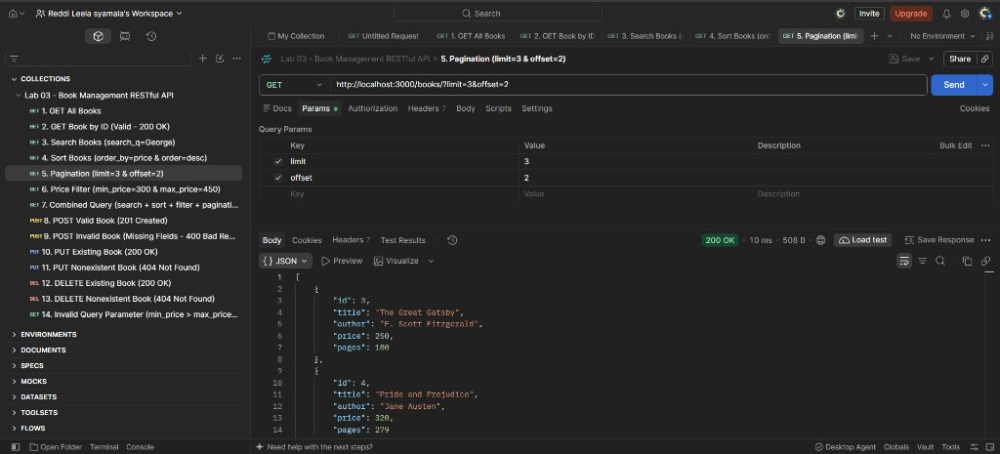
*Paginates the results skipping the first 2 records and returning the next 3 books (IDs 3, 4, 5).*

### 6. Price Filter (`GET /books/?min_price=300&max_price=450` - 200 OK)
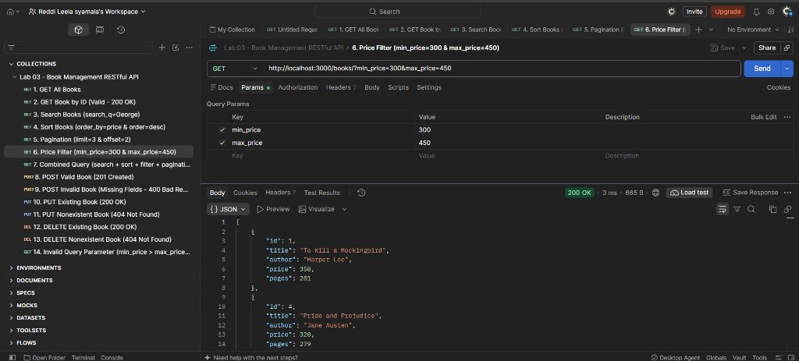
*Filters books within the price boundary of 300 to 450 inclusive using parameterized SQL conditions.*

### 7. Combined Query (`GET /books/?search_q=the&order_by=price&order=asc&min_price=200&max_price=500&limit=3&offset=0` - 200 OK)
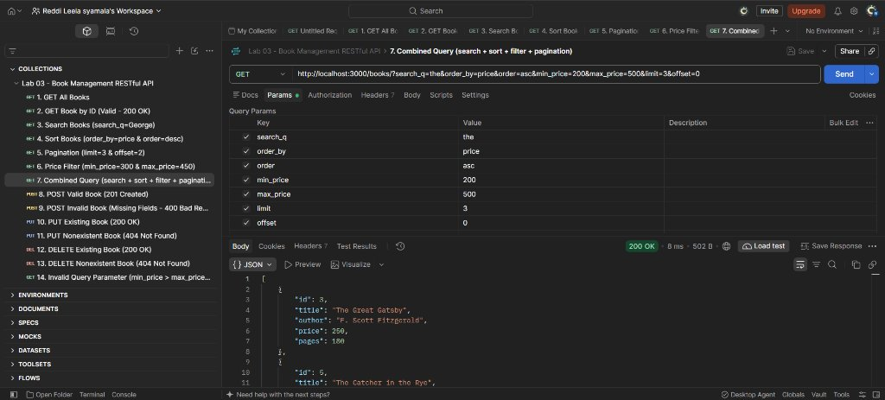
*Complex multi-parameter query combining search keyword "the", price range 200-500, ascending price sort, and limit 3.*

### 8. POST Valid Book (`POST /books/` - 201 Created)
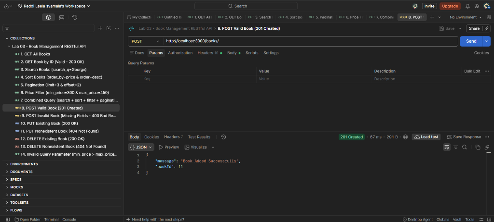
*Successfully inserts a new book with validated JSON payload and receives HTTP 201 Created and newly generated bookId 11.*

### 9. POST Invalid Book (`POST /books/` - 400 Bad Request)
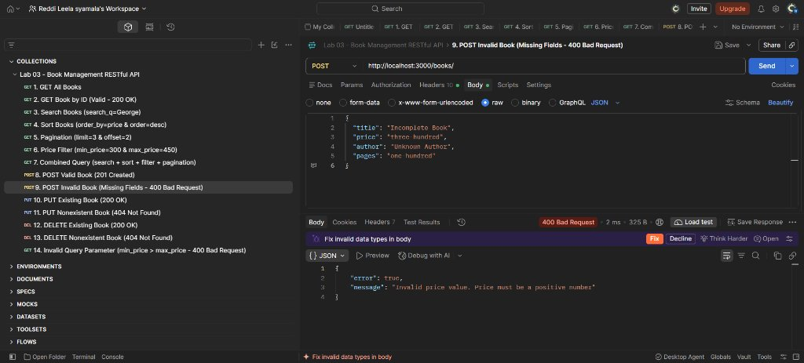
*Server rejects invalid request body containing non-numeric price string ("three hundred") with HTTP 400 Bad Request and descriptive error message.*

### 10. PUT Existing Book (`PUT /books/1/` - 200 OK)
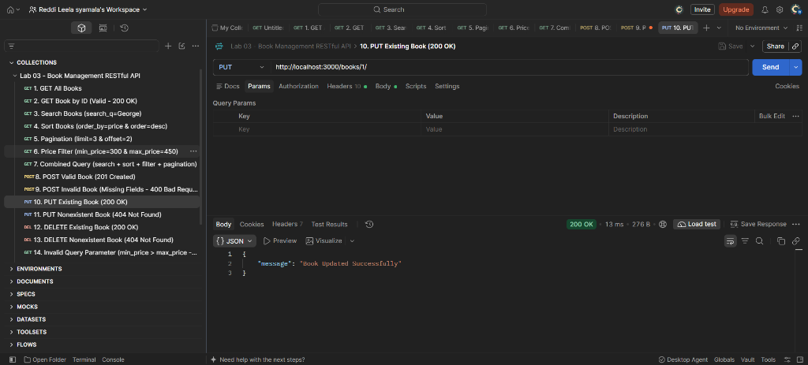
*Updates existing book record at ID 1 with new data, returning HTTP 200 OK and confirmation message.*

### 11. PUT Nonexistent Book (`PUT /books/999/` - 404 Not Found)
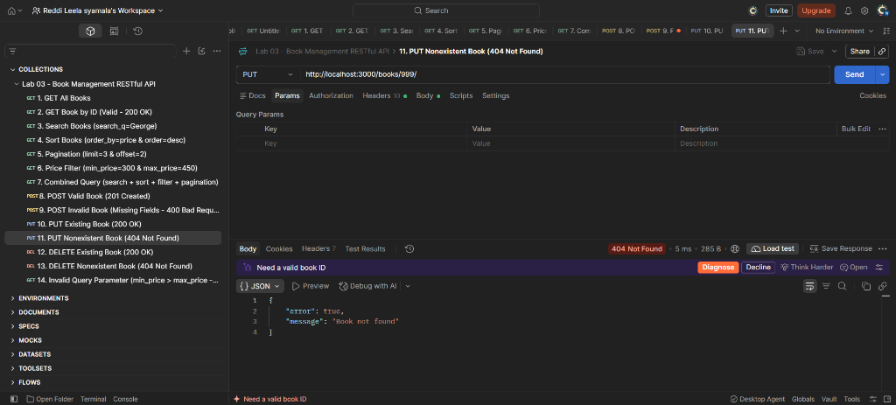
*Attempting to update a non-existent book ID (999) correctly yields HTTP 404 Not Found and uniform JSON error.*

### 12. DELETE Existing Book (`DELETE /books/10/` - 200 OK)
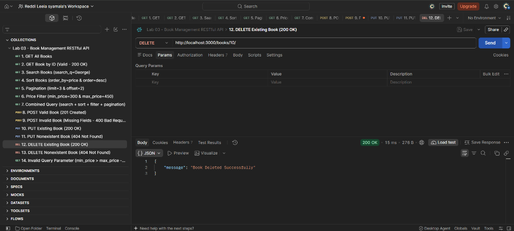
*Deletes existing book record at ID 10 ("The Pragmatic Programmer"), returning HTTP 200 OK and success confirmation.*

### 13. DELETE Nonexistent Book (`DELETE /books/999/` - 404 Not Found)
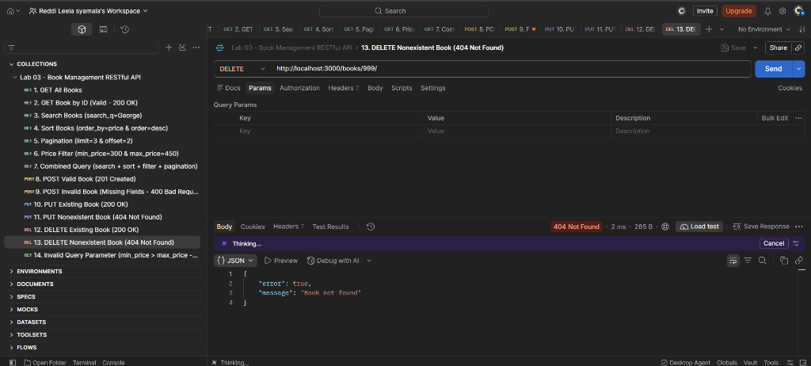
*Attempting to delete non-existent book ID (999) returns HTTP 404 Not Found.*

### 14. Invalid Query Parameter (`GET /books/?min_price=800&max_price=200` - 400 Bad Request)
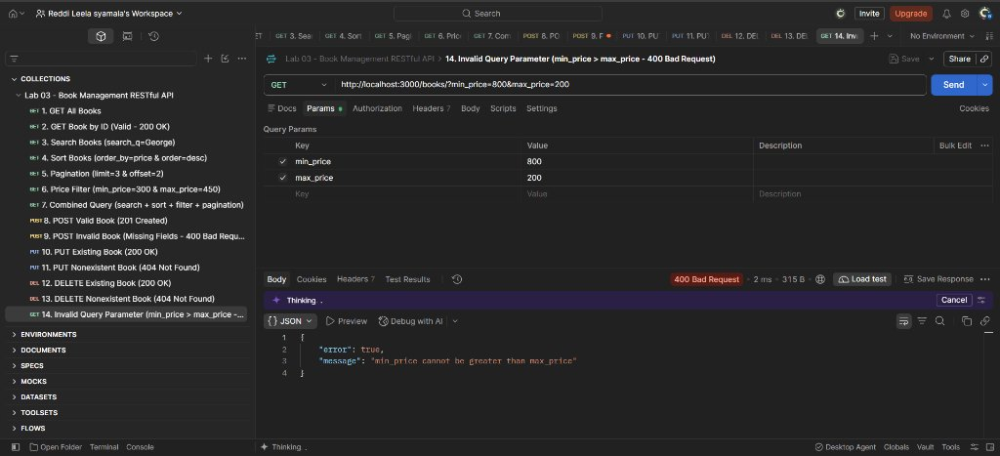
*Cross-validation detects min_price greater than max_price (800 > 200) and returns HTTP 400 Bad Request with message "min_price cannot be greater than max_price".*

---

## SQLite CLI Verification

The SQLite CLI was executed to verify schema integrity and row mutations before and after API operations.

```text
PS C:\...\lab-03> sqlite3 books.db
SQLite version 3.53.4 2026-07-24 19:02:57
Enter ".help" for usage hints.

sqlite> .tables
book

sqlite> .schema book
CREATE TABLE book (
    id INTEGER PRIMARY KEY,
    title TEXT,
    author TEXT,
    price INTEGER,
    pages INTEGER
);

sqlite> .mode column
sqlite> .headers on
sqlite> SELECT * FROM book;
id  title                     author                        price  pages
--  ------------------------  ----------------------------  -----  -----
1   To Kill a Mockingbird     Harper Lee                    350    281  
2   1984                      George Orwell                 299    328  
3   The Great Gatsby          F. Scott Fitzgerald           250    180  
4   Pride and Prejudice       Jane Austen                   320    279  
5   The Catcher in the Rye    J.D. Salinger                 399    234  
6   The Hobbit                J.R.R. Tolkien                450    310  
7   Fahrenheit 451            Ray Bradbury                  280    256  
8   Jane Eyre                 Charlotte Bronte              310    500  
9   Clean Code                Robert C. Martin              750    464  
10  The Pragmatic Programmer  Andrew Hunt and David Thomas  620    352  
```

### Mutation Verification:
1. **POST Verification:** Executed `POST /books/` with *"Design Patterns"*. Verified in CLI with `SELECT * FROM book WHERE id = 11;` returning the new row.
2. **PUT Verification:** Executed `PUT /books/1/` with updated price `499`. Verified in CLI with `SELECT * FROM book WHERE id = 1;` showing price updated from 350 to 499.
3. **DELETE Verification:** Executed `DELETE /books/11/`. Verified in CLI with `SELECT * FROM book WHERE id = 11;` returning zero rows.

---

## Deployment Guide (Render)

### Cloud Deployment Configuration

The application is engineered to deploy seamlessly on Render as a Web Service:

- **Git Repository:** [https://github.com/reddileelasyamala-creator/Lab-1](https://github.com/reddileelasyamala-creator/Lab-1)
- **Branch:** `main`
- **Root Directory:** `lab-03`
- **Environment:** `Node`
- **Build Command:** `npm install`
- **Start Command:** `npm start`
- **Health Check Path:** `/health/`

### Ephemeral Filesystem & SQLite Persistence Analysis

1. **Free Tier Ephemeral Disk:** Render's free web service containers run on an ephemeral filesystem, meaning file system writes are not retained across service rebuilds or container restarts.
2. **Built-in Self-Healing / Auto-Seeding:** To ensure the API remains fully functional on ephemeral tiers, `server.js` automatically verifies table schema existence and re-seeds the initial 10 books (`INSERT OR IGNORE`) on startup whenever an empty database is detected.
3. **Optional Persistent Disk Configuration:** For environments requiring permanent SQLite write persistence across restarts, attach a Render Persistent Disk mounted at `/var/data` and configure the environment variable:
   ```text
   DB_PATH=/var/data/books.db
   ```

### Step-by-Step Render Deployment Instructions

1. Log in to the [Render Dashboard](https://dashboard.render.com/).
2. Click **New +** and select **Web Service**.
3. Connect your GitHub account and select the repository: `reddileelasyamala-creator/Lab-1`.
4. Configure the service settings:
   - **Name:** `bdf-lab-03-book-api`
   - **Region:** Any preferred region (e.g., Singapore, Frankfurt, Oregon)
   - **Branch:** `main`
   - **Root Directory:** `lab-03`
   - **Runtime:** `Node`
   - **Build Command:** `npm install`
   - **Start Command:** `npm start`
   - **Instance Type:** `Free`
5. Click **Create Web Service**. Render will clone the repository, navigate to `lab-03`, install dependencies, and start the service with `npm start`.
6. Once deployed, test the live endpoints:
   - `GET /` -> Service information & student metadata
   - `GET /health/` -> Health check monitor
   - `GET /books/` -> Book collection with full query capabilities

---

## Problems Faced and Solutions

1. **Windows PowerShell Execution Policy Blocking `npm`:**
   - *Problem:* Running `npm` on Windows PowerShell triggered an execution policy restriction (`npm.ps1 cannot be loaded because running scripts is disabled`).
   - *Solution:* Executed commands via `npm.cmd` directly, bypassing the restricted PowerShell script wrapper.

2. **SQL Injection Vulnerability in Dynamic `ORDER BY`:**
   - *Problem:* SQLite parameter placeholders (`?`) cannot bind column names in `ORDER BY` clauses. Directly concatenating user query values exposes the database to SQL injection attacks.
   - *Solution:* Implemented strict whitelist validation against permitted column names (`['id', 'title', 'price', 'pages']`) and directions (`['ASC', 'DESC']`). Any unwhitelisted input immediately returns HTTP `400 Bad Request`.

3. **Handling SQLite Offset Without Explicit Limit:**
   - *Problem:* In SQLite syntax, specifying `OFFSET` without `LIMIT` produces a SQL syntax error.
   - *Solution:* When a user provides `offset` without `limit`, the query builder automatically applies `LIMIT -1 OFFSET ?`, which SQLite interprets as unlimited rows starting from the given offset.

4. **Catching Malformed JSON in Request Bodies:**
   - *Problem:* Express's built-in `express.json()` middleware throws an unhandled `SyntaxError` when receiving broken JSON, returning an unsightly HTML 400 error page.
   - *Solution:* Implemented custom body-parser error-handling middleware that intercepts JSON parse errors and returns a clean, uniform JSON error response.

---

## Comprehensive Viva Questions & Answers

### 1. What is REST architecture?
**Answer:** REST (Representational State Transfer) is an architectural style for designing networked applications. It relies on a stateless, client-server protocol (almost always HTTP), standard HTTP methods, and unique URIs to represent and manipulate resources.

### 2. What makes an API "RESTful"?
**Answer:** An API is RESTful when it adheres to REST constraints: stateless communication, resource identification through URIs, manipulation of resources through standard representations (JSON/XML), self-descriptive messages (using HTTP headers and status codes), and standard HTTP methods (`GET`, `POST`, `PUT`, `DELETE`).

### 3. What are the key HTTP methods and their purposes?
**Answer:**
- `GET`: Safe and idempotent retrieval of resource representations.
- `POST`: Non-idempotent creation of a new subordinate resource.
- `PUT`: Idempotent replacement or complete update of a target resource.
- `DELETE`: Idempotent removal of a target resource.
- `PATCH`: Partial modification of an existing resource.

### 4. What is the difference between Query Parameters and Route Parameters?
**Answer:**
- **Route Parameters (`/books/:bookId`):** Part of the URI path used to identify a specific, unique resource.
- **Query Parameters (`/books/?order_by=price`):** Optional key-value pairs appended after `?` used to filter, sort, search, or paginate a collection of resources without changing the resource identity.

### 5. What is the difference between filtering, searching, and sorting?
**Answer:**
- **Searching:** Pattern-matching text across attributes (e.g. `title LIKE '%George%'`).
- **Filtering:** Narrowing down results based on specific criteria or ranges (e.g. `price >= 300`).
- **Sorting:** Arranging the retrieved result set in ascending or descending sequence based on an attribute.

### 6. What is pagination and why is it essential in RESTful APIs?
**Answer:** Pagination divides large datasets into smaller subsets using parameters like `limit` and `offset` (or cursor/page tokens). It prevents server memory exhaustion, reduces network bandwidth, and drastically improves client response times.

### 7. What is input validation and why must it occur server-side?
**Answer:** Input validation verifies that incoming client data conforms to expected formats, data types, and business rules before processing. It must be performed on the server because client-side validation can easily be bypassed using curl, Postman, or custom scripts.

### 8. Explain common HTTP status codes used in REST APIs.
**Answer:**
- `200 OK`: Request succeeded.
- `201 Created`: Resource successfully created (used with POST).
- `400 Bad Request`: Client sent invalid syntax, malformed JSON, or failed validation.
- `404 Not Found`: The requested URI or resource ID does not exist.
- `500 Internal Server Error`: Unhandled server-side exception.

### 9. Why should API error responses use consistent JSON instead of default HTML?
**Answer:** API clients (mobile apps, frontends, microservices) parse JSON programmatically. HTML error pages break client deserializers, causing client-side crashes and obscuring error messages.

### 10. What is SQL Injection and how do parameterized queries prevent it?
**Answer:** SQL Injection occurs when untrusted user input is directly concatenated into a SQL statement, allowing attackers to manipulate query syntax. Parameterized queries (`?` placeholders) separate the SQL query structure from data values, ensuring the database engine treats user input strictly as literal values.

### 11. Why cannot `ORDER BY` column names be parameterized with `?` in SQLite?
**Answer:** SQLite parameters only bind data literals, not database schema identifiers (table or column names). Binding a column with `?` results in SQLite treating it as a string literal (e.g. `ORDER BY 'price'`), which sorts nothing. Whitelisting permitted column names is the safe and correct solution.

### 12. Why do we use `async` and `await` with SQLite operations in Node.js?
**Answer:** Disk I/O and database operations are asynchronous. `await` halts function execution until the database driver resolves the Promise, ensuring variables receive actual query rows instead of unresolved pending Promises.

### 13. What is the `EADDRINUSE` error and how do you resolve it?
**Answer:** `EADDRINUSE` means "Error: Address already in use", indicating another process is already bound to that TCP port. It is resolved by terminating the lingering process (`Stop-Process` or `kill`) or switching to a different port via `process.env.PORT`.

### 14. What are the advantages and limitations of SQLite in production?
**Answer:**
- **Advantages:** Zero configuration, serverless embedded architecture, ACID compliant, extremely fast for read-heavy workloads, single file storage.
- **Limitations:** Database file is local to the filesystem (fails on ephemeral serverless containers without persistent disks) and does not support high-concurrency multi-client distributed writes.

---

## GitHub Repository

Repository URL: [https://github.com/reddileelasyamala-creator/Lab-1](https://github.com/reddileelasyamala-creator/Lab-1)

